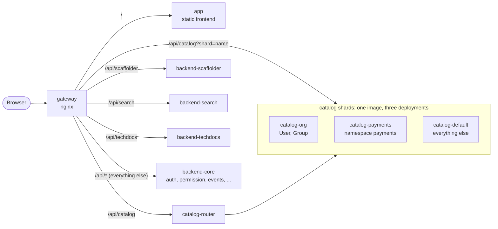

# Backstage, split into independently built and scaled services

A proof of concept for running [Backstage](https://backstage.io) (1.55) as
[multiple backends](https://backstage.io/docs/backend-system/building-backends/index#split-into-multiple-backends)
behind one nginx gateway, with the software catalog split into shards that are
picked from each request's own query parameters.

- **One image per service**, each with its own Dockerfile, built and pushed on
  its own: five backends, a catalog router, the frontend and the gateway.
- **Fast builds**: bundles are built on the host, and each backend's
  dependency layer is keyed on a lockfile pruned to *that backend's*
  production dependencies. A code change rebuilds an image in about 3 s; a
  dependency bump in one backend leaves every other image's cache intact.
- **Independent scaling**: every deployment scales on its own
  (`task scale SERVICE=... REPLICAS=...`), and traffic follows new replicas.
- **Query-based catalog sharding**: `/api/catalog` is served by three catalog
  deployments (people and teams; the `payments` namespace; everything else).
  A router sends each request only to the shards that can match it, and
  merges answers when several can. The UI, search, TechDocs and the scaffolder
  see one catalog.

The full design, measurements, limitations and the path to production are in
[docs/PLAN.md](docs/PLAN.md).



Backends call each other through the gateway too: their discovery config
resolves every plugin to `http://gateway:8080/api/<pluginId>`, so the gateway
is the only place that knows which deployment hosts which plugin.

## Quick start

Requirements: Docker with Compose v2 (BuildKit on), Node 22 or 24, and
[Task](https://taskfile.dev/installation/). Yarn is pinned in `.yarn/releases`.

```sh
task build    # host bundles + one image per service, all in parallel
task up       # start everything; Backstage is at http://localhost:8080
task smoke    # check routing, sharding, auth, search and TechDocs end to end
```

Sign in as the guest user. On the catalog page, "All" lists components from two
shards as one sorted list; open `team-payments` to see its ownership, which
lives in another shard than the team itself.

Behind a TLS-intercepting proxy, pass its CA to image builds:
`task build EXTRA_CA_CERT=/path/to/ca.pem`.

## Everyday tasks

| Task | What it does |
| --- | --- |
| `task build` | Build every image, in parallel. Unchanged bundles are skipped. |
| `task image:backend-search` | Build one image (any of the eight). |
| `task deploy:backend-search` | Rebuild one image and roll only its containers. |
| `task push REGISTRY=ghcr.io/acme` | Push every image (`push:<service>` for one). |
| `task release:backend-search REGISTRY=...` | Build and push one service. |
| `task scale SERVICE=catalog-default REPLICAS=3` | Scale one deployment. |
| `task logs -- catalog-router gateway` | Follow logs. |
| `task check` | Type-check and unit tests. |
| `task e2e` | Browser tests against the running stack. |
| `task down` / `task reset` | Stop (and with `reset`, delete the database). |

Images are named `<REGISTRY>/backstage-poc/<service>:<TAG>`; `TAG` defaults
to `dev`. `task registry` starts a throwaway registry on `localhost:5000` if you
want to try pushing locally.

## Trying the catalog routing

Every catalog response says how it was routed:

```sh
TOKEN=$(curl -s -X POST localhost:8080/api/auth/guest/refresh | jq -r .backstageIdentity.token)
api() { curl -s -D - -o /dev/null -H "authorization: Bearer $TOKEN" "localhost:8080/api/catalog/$1" | grep -i x-catalog; }

api 'entities/by-query?filter=kind=group'                # single: org
api 'entities/by-name/component/payments/ledger'         # single: payments
api 'entities/by-query?filter=kind=component'            # fanout: payments,default
api 'entity-facets?facet=kind'                           # fanout: org,payments,default
```

`?shard=<name>` (or an `X-Catalog-Shard` header) makes the gateway send a
request straight to one shard, bypassing the router.

## Repository layout

| Path | Contents |
| --- | --- |
| `packages/app` | Frontend, plus its nginx image and runtime-config entrypoint |
| `packages/backend-core` | auth, permission, events, proxy, notifications, signals, user settings, kubernetes, MCP actions |
| `packages/backend-catalog` | The catalog, plus the shard guard module. One image, one deployment per shard |
| `packages/backend-scaffolder` | Software templates |
| `packages/backend-search` | Search API, Postgres engine, catalog and TechDocs collators |
| `packages/backend-techdocs` | TechDocs, in the one image that carries Python and MkDocs |
| `packages/catalog-router` | Shard-aware router for `/api/catalog` (no runtime dependencies) |
| `packages/catalog-sharding` | Shard rules shared by the router and the guard, inlined into both at build time |
| `gateway/` | The nginx gateway image |
| `deploy/` | Shard topology (`catalog-shards.json`) and per-shard catalog config |
| `docker/` | Entrypoint shared by the backend images |
| `scripts/` | Lockfile pruning and the smoke test |
| `app-config*.yaml` | Config shared by all backends; per-deployment config is mounted into `/app/config.d` |
| `Taskfile.yml`, `docker-compose.yml` | Orchestration |
